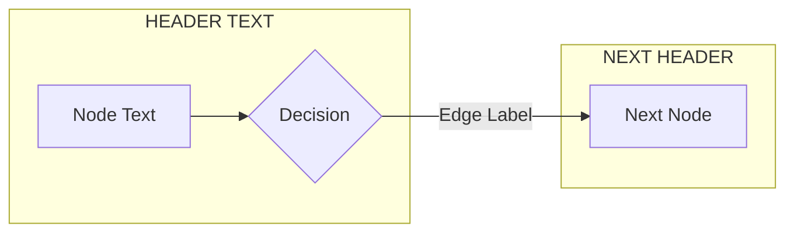

# 流程图二次解析对比：GLM-OCR vs Qwen3.5-9B

本文档记录版面裁剪图（`imgs/`）二次 VL 解析时，**GLM-OCR** 与 **Qwen3.5-9B** 在同一批 NCCN 流程图上的模型、输入、Prompt 与输出差异。

对照样本：`job_id = cd33c76a-839d-4958-ab85-e16d80ecb72e`（`all-nccn-2026.pdf` 的 `document_0/imgs`，共 5 张流程图裁剪）。

---

## 1. 用的模型 / 服务

| 项 | GLM-OCR（当前 v3 默认） | Qwen3.5-9B（单独评测） |
|---|---|---|
| 模型名 | `glm-ocr` | `qwen3.5-9b` |
| 推理服务 | vLLM `http://127.0.0.1:18080/v1`（经网关时走 glm-ocr-v3 内部调用） | vLLM `http://172.19.64.72/vllm-qwen38/v1` |
| 对外入口 | `http://172.19.64.72/glm-ocr-v3` / 本机 `:18094` | 直接调 OpenAI 兼容 `/chat/completions` |
| 模型定位 | 文档 OCR / 版面区域识别为主 | 通用多模态（视觉理解 + 结构化生成更强） |
| 在流水线中的角色 | Layout 后对 `imgs/` 二次调用（figure enrichment） | 本次为同图、同 Prompt 的独立对比实验 |

说明：GLM-OCR v3 整页/PDF 主链路仍是 **PP-DocLayoutV3 + glm-ocr**；本文只对比 **裁剪流程图 → 文本/Mermaid** 这一步。

---

## 2. 输入

两边输入相同：

| 项 | 内容 |
|---|---|
| 图片目录 | `.../cd33c76a-.../document_0/imgs/` |
| 文件 | `cropped_page13_idx0.jpg` … `cropped_page19_idx4.jpg`（5 张） |
| 请求格式 | OpenAI 风格多模态：`image_url`（data URL / base64）+ `text` prompt |
| 温度 | `0.0` |
| 任务 | 临床流程图 → 可执行 Mermaid（优先），不能结构化则 Image Caption |

图片来源：先由 **glm-ocr-v3** layout 识别出 `image/chart` 区域并裁剪，再分别送给两个 VL。

---

## 3. Prompt

对比实验使用同一套临床专用 Prompt（v3 配置里的 `mermaid_clinical` / `MERMAID_CLINICAL_PROMPT`）：

- Role：Mermaid Chart Expert & OCR Specialist  
- 要求：`flowchart LR`（除非明显上下结构）、`subgraph` 表示栏目标题、`<br>` 多行、脚注原样转录  
- 输出：**只输出 Mermaid 代码块**；非流程图则 `**Image Caption:** ...`

完整 Prompt 见：

- `code/glm_ocr/services/glm_ocr_v3/figure_enrichment.py` → `MERMAID_CLINICAL_PROMPT`
- `code/glm_ocr/config/ocr_services_v3.yaml` → `figure_enrichment.fallback_prompt_profile: mermaid_clinical`

> 注：线上 v3 默认仍是 `prompt_profile: default`，失败/非 Mermaid 时再 fallback 到 `mermaid_clinical`。  
> 本次 Qwen 评测是 **直接只用** `mermaid_clinical`。GLM 侧产物来自该 job 的 `figure_texts/`（当时 enrichment 已开启）。

---

## 4. 同图结果对比（摘要）

| 裁剪图 | GLM-OCR 输出形态 | GLM 体量 | Qwen3.5-9B 输出形态 | Qwen Mermaid 体量 |
|---|---|---:|---|---:|
| `cropped_page13_idx0` | ` ```markdown ` 简短箭头列表 | ~84 | ` ```mermaid ` + subgraph | ~717 |
| `cropped_page14_idx1` | 极简 Mermaid | ~186 | 完整 Mermaid（节点/脚注更全） | ~2089 |
| `cropped_page16_idx2` | ` ```markdown ` 文本块（非图） | ~546 | `flowchart LR` + RISK/INDUCTION/CONSOLIDATION subgraph | ~2029 |
| `cropped_page17_idx3` | 极简 Mermaid | ~186 | 完整 Mermaid | ~1652 |
| `cropped_page19_idx4` | 偏文本/半结构 | ~408 | 完整 Mermaid | ~1233 |

job 元数据中 GLM 侧 `kind`：多数为 `structured`，少数标为 `flowchart`；Qwen 侧 5/5 都抽出了可用 Mermaid。

---

## 5. 逐图完整结果对照

以下为同目录 5 张裁剪图的 **GLM-OCR `figure_texts`** 与 **Qwen3.5-9B 抽取后的纯 Mermaid** 全文。

### 5.1 `cropped_page13_idx0.jpg` — 分型入口（Ph+ / Ph- / T-ALL → Treatment）

#### GLM-OCR

````text
```markdown
Ph+ B-ALL --> Treatment
Ph- B-ALL --> Treatment
T-ALL --> Treatment
```
````

#### Qwen3.5-9B

```mermaid
flowchart LR
    %% Define styles
    classDef linkStyle color: blue; text-decoration: underline;

    %% Origin node on the left
    Origin((Start))

    %% Middle Column: Subtypes
    subgraph Subtypes
        direction TB
        PhPlus[Ph+ B-ALL]
        PhMinus[Ph- B-ALL]
        TALL[T-ALL]
    end

    %% Right Column: Treatments
    subgraph Treatments
        direction TB
        T4[Treatment<br>(ALL-4)]
        T5[Treatment<br>(ALL-5)]
        T6[Treatment<br>(ALL-6)]
    end

    %% Connections
    Origin --> PhPlus
    Origin --> PhMinus
    Origin --> TALL

    PhPlus --> T4
    PhMinus --> T5
    TALL --> T6

    %% Apply styling to treatment nodes
    class T4, T5, T6 linkStyle
```


### 5.2 `cropped_page14_idx1.jpg` — Ph+ B-ALL pathway

#### GLM-OCR

````text

````

#### Qwen3.5-9B

```mermaid
flowchart LR
    %% Define styles
    classDef link fill:#f9f9f9,stroke:#333,stroke-width:2px;
    classDef decision fill:#fff,stroke:#333,stroke-width:2px;
    classDef text fill:#fff,stroke:#333,stroke-width:2px;

    %% Start
    Start[Ph+ B-ALL<sup>w</sup>] --> Induction[Clinical trial (preferred) or Systemic therapy + tyrosine kinase inhibitor (TKI)<sup>y,aa</sup>]
    
    Induction --> Assessment[Response assessment (ALL-E)]
    
    %% Branch 1: Less than CR
    Assessment --> LessCR[Less than marrow CR]
    LessCR --> MolTest1[ABL1 kinase domain molecular testing<sup>ee</sup>]
    MolTest1 --> Relapse[Relapsed/Refractory Disease (ALL-8)]

    %% Branch 2: CR
    Assessment --> CR[Marrow complete remission (CR)<sup>bb</sup>]
    
    %% From CR, split into MRD+ and MRD-
    CR --> MRDPlus[MRD+ (ALL-F)<sup>cc,dd</sup>]
    CR --> MRDMinus[MRD- (ALL-F)<sup>cc</sup>]
    
    %% Path from MRD+
    MRDPlus --> MolTest2[ABL1 kinase domain molecular testing<sup>ee</sup>]
    MolTest2 --> TreatmentPlus[Blinatumomab + TKI (preferred)<sup>aa,ff,gg,hh</sup> or Multiagent therapy + TKI<sup>aa,gg,ii</sup> or TKI<sup>aa,gg,jj</sup>]
    TreatmentPlus --> MRDCR[MRD- CR<sup>bb,cc,nn</sup> (ALL-F)]
    
    %% Path from MRD-
    MRDMinus --> TreatmentMinus[Blinatumomab + TKI<sup>aa,ff,hh</sup> or Continue multiagent therapy + TKI<sup>aa</sup> or TKI<sup>aa,jj</sup> or Allogeneic hematopoietic cell transplant (HCT) in appropriate candidates<sup>kk,ll,mm</sup>]
    
    %% From TreatmentMinus, split into MRD- CR and Progression
    TreatmentMinus --> MRDCR
    TreatmentMinus --> Progression[Persistent, progressive, or emergent MRD or marrow progression/extramedullary disease<sup>cc,nn</sup>]
    
    %% From Progression
    Progression --> MolTest3[ABL1 kinase domain molecular testing<sup>ee</sup>]
    MolTest3 --> Relapse
    
    %% From MRD- CR
    MRDCR --> Maintenance[Consider allogeneic HCT + post-HCT TKI maintenance when feasible<sup>aa,kk,ll,mm</sup> or TKI maintenance<sup>aa,oo</sup>]
    Maintenance --> Surveillance[Surveillance (ALL-7)]
```


### 5.3 `cropped_page16_idx2.jpg` — Ph- B-ALL pathway（含 RISK / INDUCTION / CONSOLIDATION）

#### GLM-OCR

````text
```markdown
RISK STRATIFICATIONᵇ TREATMENT INDUCTIONᵇᵇ CONSOLIDATION THERAPYᵇᵇ

MRD+ (ALL-F)ᵇᵇ Blinatumomab (preferred) + continued multiagent therapyᵃᵃ,ff,qq or Blinatumomabᵃᵃ
MRD- (ALL-F)ᵇᵇ Blinatumomab (preferred) + continued multiagent therapyᵃᵃ,ff,qq or Blinatumomabᵃᵃ or Consider allogeneic HCT (especially if high-risk features)ᵇᵇᵇ
MRD- CR (ALL-F)ᵇᵇ Allogeneic HCTᵇᵇᵇ or POMP maintenanceᵇᵇ
Surveillance (ALL-7)
Persistent, progressive, or emergent MRD or marrow progression/extramedullary diseaseᵇᵇ
Relapsed/Refractory Disease (ALL-8)
```
````

#### Qwen3.5-9B

```mermaid
flowchart LR
    %% Define Styles
    classDef blueLink fill:none,stroke:none,font-weight:bold,font-size:14px;
    classDef box fill:#fff,stroke:#333,stroke-width:1px;
    
    %% Start
    Start[Ph-B-ALL]
    
    %% Subgraph 1: Risk Stratification
    subgraph RiskStrat [RISK STRATIFICATION]
        direction TB
        Node1[|Clinical trial<br>(preferred)<br>or Systemic therapy<sup>y,aa</sup>|]
        Node2[Response Assessment<br>(ALL-E)]
    end
    
    %% Subgraph 2: Treatment Induction
    subgraph TreatInd [TREATMENT INDUCTION]
        direction TB
        Node3[Marrow CR<sup>pp</sup>]
        Node4[MRD+<br>(ALL-F)<sup>cc</sup>]
        Node5[MRD-<br>(ALL-F)<sup>cc</sup>]
        Node6[Less than marrow CR]
        Node7[Consider NGS]
    end
    
    %% Subgraph 3: Consolidation
    subgraph Consol [CONSOLIDATION THERAPY]
        direction TB
        Node8[|Blinatumomab<br>(preferred) + continued multiagent therapy<sup>aa,ff,qq</sup><br>or Blinatumomab<sup>rr</sup>|]
        Node9[|Blinatumomab<br>(preferred) + continued multiagent therapy<sup>aa,ff,qq</sup><br>or Blinatumomab<sup>rr</sup><br>or Consider allogeneic HCT<br>(especially if high-risk features)<sup>v,mm</sup>|]
    end
    
    %% Outcomes (No header subgraph, just nodes)
    Node10[MRD- CR<br>(ALL-F)<sup>cc,pp</sup>]
    Node11[|Allogeneic HCT<sup>ll,mm</sup><br>or POMP maintenance<sup>ss</sup>|]
    Node12[|Persistent, progressive,<br>or emergent MRD or marrow progression/<br>extramedullary disease<sup>cc</sup>|]
    Node13[Surveillance<br>(ALL-7)]
    Node14[Relapsed/Refractory Disease<br>(ALL-8)]

    %% Connections
    Start --> Node1
    Node1 --> Node2
    Node2 --> Node3
    Node2 --> Node6
    Node6 --> Node7
    Node3 --> Node4
    Node3 --> Node5
    Node4 --> Node8
    Node5 --> Node9
    Node7 --> Node14
    
    Node8 --> Node10
    Node9 --> Node10
    Node9 --> Node12
    
    Node10 --> Node11
    Node11 --> Node13
    Node12 --> Node14

    %% Styling
    class Node2,Node13,Node14 blueLink;
```


### 5.4 `cropped_page17_idx3.jpg` — T-ALL pathway

#### GLM-OCR

````text

````

#### Qwen3.5-9B

```mermaid
flowchart LR
    %% Nodes
    TALL[T-ALL]
    ClinicalTrial[Clinical trial<br>(preferred)<br>or<br>Systemic therapy<sup>aa</sup>]
    ResponseAssessment[Response Assessment<br>(ALL-E)]
    MarrowCR[Marrow CR<sup>pp</sup>]
    LessMarrowCR[Less than<br>marrow<br>CR]
    MRDPlus[MRD+<br>(ALL-F)<sup>cc</sup>]
    MRDMinus[MRD-<br>(ALL-F)<sup>cc</sup>]
    ContinueTherapy1[Continue multiagent therapy<sup>aa</sup>]
    ContinueTherapy2[Continue multiagent therapy<sup>aa</sup><br>or<br>Consider allogeneic HCT<sup>mm,uu</sup>]
    MRDCR[MRD- CR<br>(ALL-F)<sup>cc,pp</sup>]
    AllogeneicHCT[Allogeneic HCT<sup>mm,uu</sup><br>or<br>POMP maintenance<sup>vv</sup>]
    Surveillance[Surveillance<br>(ALL-7)]
    PersistentDisease[Persistent, progressive,<br>or emergent MRD or<br>marrow progression/<br>extramedullary disease<sup>cc</sup>]
    RelapsedDisease[Relapsed/<br>Refractory<br>Disease<br>(ALL-8)]
    ConsiderNGS[Consider<br>NGS]

    %% Connections
    TALL --> ClinicalTrial
    ClinicalTrial --> ResponseAssessment
    ResponseAssessment --> MarrowCR
    ResponseAssessment --> LessMarrowCR
    MarrowCR --> MRDPlus
    MarrowCR --> MRDMinus
    MRDPlus --> ContinueTherapy1
    MRDMinus --> ContinueTherapy2
    ContinueTherapy2 --> MRDCR
    MRDCR --> AllogeneicHCT
    MRDCR --> PersistentDisease
    AllogeneicHCT --> Surveillance
    PersistentDisease --> RelapsedDisease
    LessMarrowCR --> ConsiderNGS
    ConsiderNGS --> RelapsedDisease

    %% Styling
    classDef blueLink fill:none,stroke:none,color:#0056b3,font-weight:bold;
    class ResponseAssessment,MRDPlus,MRDMinus,MRDCR,Surveillance,RelapsedDisease blueLink;
```


### 5.5 `cropped_page19_idx4.jpg` — Relapsed/refractory 分支

#### GLM-OCR

````text
DISEASE

Ph+ B-ALL --> ABL1 kinase domain molecular testing<sup>ee</sup> --> Clinical trial
Relapsed/refractory regimens (ALL-D 24 of 29)

Ph- B-ALL --> Molecular analysis and MRD assessment, if not previously done (ALL-1) (ALL-F) --> Clinical trial
Relapsed/refractory regimens<sup>aaa</sup> (ALL-D 26 of 29)

T-ALL --> Clinical trial (preferred)
Relapsed/refractory regimens<sup>aaa</sup> (ALL-D 28 of 29)
````

#### Qwen3.5-9B

```mermaid
flowchart LR
    %% Define Styles
    classDef linkStyle fill:#e0f7fa,stroke:#006064,stroke-width:2px;
    classDef boxStyle fill:#ffffff,stroke:#333,stroke-width:1px;

    %% Main Start Node
    Start[Relapsed/refractory<sup>yy,zz</sup>]

    %% Branch 1: Ph+ B-ALL
    PhPlus[Ph+ B-ALL]
    TestPlus[ABL1 kinase domain<br>molecular testing<sup>ee</sup>]
    TreatPlus[• Clinical trial<br>• Relapsed/refractory regimens<sup>aaa</sup><br>(ALL-D 24 of 29)]

    %% Branch 2: Ph- B-ALL
    PhMinus[Ph- B-ALL]
    TestMinus[Molecular analysis and<br>MRD assessment, if not<br>previously done<br>(ALL-1) (ALL-F)]
    TreatMinus[• Clinical trial<br>• Relapsed/refractory regimens<sup>aaa</sup><br>(ALL-D 26 of 29)]

    %% Branch 3: T-ALL
    TAll[T-ALL]
    TreatTAll[• Clinical trial (preferred)<br>• Relapsed/refractory regimens<sup>aaa</sup><br>(ALL-D 28 of 29)]

    %% Final Node
    Final[Consider HCT<sup>mm,bbb,ccc,ddd</sup>]

    %% Connections
    Start --> PhPlus
    Start --> PhMinus
    Start --> TAll

    PhPlus --> TestPlus
    TestPlus --> TreatPlus

    PhMinus --> TestMinus
    TestMinus --> TreatMinus

    TAll --> TreatTAll

    TreatPlus --> Final
    TreatMinus --> Final
    TreatTAll --> Final
```


## 6. 总体差异结论

| 维度 | GLM-OCR | Qwen3.5-9B |
|---|---|---|
| 格式遵从 | 常落到 `markdown` / 极简图；Mermaid 不稳定 | 更稳定产出 `flowchart` + `subgraph` |
| 细节密度 | 偏压缩、丢节点/脚注/边标签 | 节点、脚注、多行文本更完整 |
| 可执行性 | 多数不能直接当 Mermaid 渲染 | 抽出代码块后多数可渲染（语法偶发需小修） |
| Prompt 遵从 | 对“只输出 Mermaid”执行偏弱 | 仍常夹带长段思考，需后处理抽 ` ```mermaid ` |
| 延迟（本批 5 图） | 嵌在整页 job 内（该 job 总 ~249s） | 单图约 34–84s，合计约 ~5 min |
| 适合场景 | 正文 OCR、版面主链路 | 临床 pathway → 可编辑流程图 |

**一句话：**  
同一 Prompt 下，**Qwen3.5-9B 更适合把 NCCN 流程图转成可编辑 Mermaid**；**GLM-OCR 更适合做文档 OCR / layout 主链路**，二次图转码时往往偏“短文本/结构化摘要”，而不是完整流程图代码。

---

## 7. 产物路径

| 内容 | 路径 |
|---|---|
| 原始裁剪图 | `C:\Users\wilson\Downloads\cd33c76a-.../document_0/imgs/` |
| GLM-OCR figure 结果 | `.../figure_texts/*.md`（同 job） |
| Qwen 原始回复 | `result/glm_ocr/qwen35_mermaid_test/*.md` |
| Qwen 纯 Mermaid | `result/glm_ocr/qwen35_mermaid_test/mermaid_only/*.md` |
| 本对比文档 | `code/glm_ocr/services/glm_ocr_v3/FIGURE_VL_COMPARE.md` |

---

## 8. 后续可选

1. 将 v3 `figure_enrichment` 的 VL 后端切到 Qwen（或 flowchart 专用路由）。  
2. 对 Qwen 增加后处理：强制只保留最后一个 ` ```mermaid ` 块。  
3. 用同一批图做定量评测（节点召回、边召回、脚注保留率、Mermaid 可解析率）。
